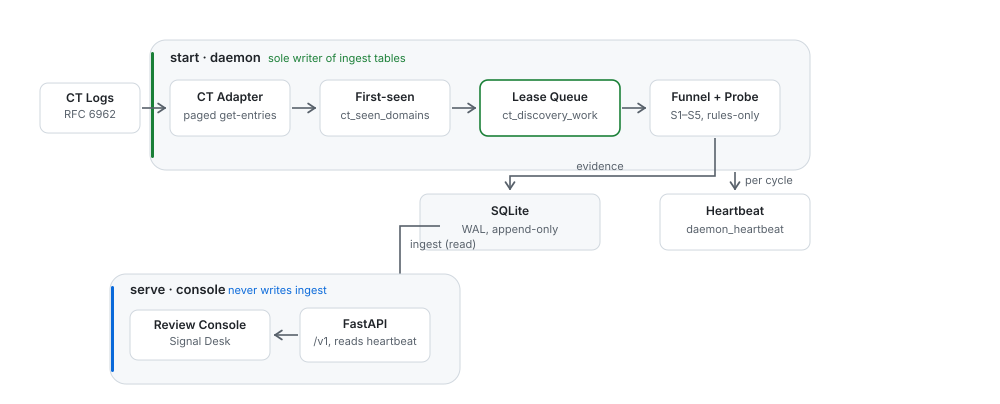

**English** | [简体中文](README.zh-CN.md)

# AI Tools Before Launch

Find AI tools the day they register a domain — by watching the
certificate transparency logs, not by waiting for someone to post about
them.

Every AI tool needs a domain, and a domain needs a TLS certificate before
it can serve anything. Certificate Transparency logs publish those
certificates within minutes of issuance. Product Hunt listings and GitHub
stars happen when someone decides to market the tool — a human decision
with no fixed timetable. CT log entries are mechanical: the certificate
exists, so the entry appears. That makes them the earliest public signal
that a tool exists at all. This tool watches
configured public CT logs, keeps a first-seen baseline, and runs a
five-stage funnel — static name signals, RDAP registration age, DNS
presence, live HTTP probing, and optional LLM classification — so a
single reviewer gets a short queue of *actually new* domains that look
like real AI products, each with a full evidence chain.

Small and dependency-light: pure HTTP, no WebSocket, no third-party
aggregator, no API keys. Any OpenAI-compatible LLM works.

## How it works



`start` is the only writer of ingest tables. `serve` reads them and writes
only review decisions, so the two processes never race over the cursor. The
diagram source is [`docs/architecture.json`](docs/architecture.json).

The pipeline flows left to right:

| Stage | What it does |
|---|---|
| CT logs | Poll configured RFC 6962 logs (default: Cloudflare Nimbus 2026) |
| First-seen baseline | `ct_seen_domains` — first sighting is the signal |
| S1 static signals | Domain-name shape score: brand-like vs random spam (evidence only by default; `--min-name-score` makes it gate) |
| S2 RDAP age | ≤30d → tier 1 · ≤90d → tier 2 · older → drop (endpoint table from the IANA bootstrap, 1,200+ TLDs) |
| S3 DNS presence | Does the domain resolve at all? |
| S4 live probe | Bounded HTTP probe, SSRF-guarded, evidence quotes |
| S5 LLM classify | Optional, fixed schema, evidence-restricted |
| Review queue | Human review inbox |

Every stage's output is persisted, and the review console shows *why*
a candidate is in the queue. Failed probes are retried automatically
(`ct_discovery_work`) — no separate scheduler needed.

## Quickstart

```bash
git clone https://github.com/Ne0x-ai/ai-tools-before-launch.git
cd ai-tools-before-launch
python3 -m venv .venv
.venv/bin/pip install -e .          # Windows: .venv\Scripts\pip install -e .
.venv/bin/python -m pytest -q       # test suite
```

> macOS + Python 3.14 only: `site.py` skips hidden `.pth` files, which breaks
> editable installs. Run `bash dev_install.sh` instead of plain pip — it does
> the same install plus the fix. Linux and Windows never need this.

Foreground running is the same everywhere: start the command, it runs until
`Ctrl-C`. The next section is only for keeping it alive when you are away.

## Commands

There are four:

```bash
ai-tools-before-launch init --database ./ai-tools-before-launch.db        # create/open the DB

ai-tools-before-launch start    --database ./ai-tools-before-launch.db    # continuous discovery
ai-tools-before-launch serve  --database ./ai-tools-before-launch.db      # review inbox UI
ai-tools-before-launch status --database ./ai-tools-before-launch.db      # known + due domains
```

### Continuous discovery

```bash
ai-tools-before-launch start \
  --database ./ai-tools-before-launch.db \
  --entries 500000 \
  --provider openai-compatible --base-url "https://api.deepseek.com" \
  --token-env DEEPSEEK_TOKEN --model "deepseek-chat"
```

One round = poll new CT entries → strict first-seen/RDAP/DNS gates →
bounded HTTP probe → candidates queued for review. Repeat `--log` to
poll more sources. Runs forever until Ctrl-C; with `--max-rounds` a
source failure exits non-zero instead of looking like "no candidates".

By default discovery runs rules-only (S1-S4, no LLM, no API key). To
attach S5 classification, add `--provider openai-compatible` plus the
endpoint flags. Providers known to
work: DeepSeek (`deepseek-chat`), MiniMax (`MiniMax-M3`), OpenAI
(`gpt-4o-mini`), Ollama (`http://localhost:11434`), vLLM. Reasoning
models are handled (thinking preambles stripped, JSON extracted from
fenced or tail blocks, `base_url` normalized with or without `/v1`).

### Review inbox

```bash
ai-tools-before-launch serve --database ./ai-tools-before-launch.db
# open http://127.0.0.1:8000/
```

The home page is the candidate inbox: undecided candidates sorted by
review priority. Click into a candidate to see its persisted evidence,
then approve, defer, reject, or blocklist. Actions require an
`X-Actor-ID` and are recorded in SQLite.

**The console does not read CT logs.** Ingestion has exactly one writer, the
`start` daemon, and running two of them would mean two processes advancing the
same cursor. `serve` can only *drain* the work queue the daemon already filled
(`POST /v1/run/discovery`), and it tells you which of the two situations you are
in: `no_work` with `daemon.running: false` means nothing is being collected,
while `no_work` with `daemon.running: true` means you are caught up. Run
`start` in another terminal — or under systemd/launchd — for the console to
have anything to show.

### How `start` behaves

`start` sweeps every new CT entry to the tree head with bounded
parallelism, digests the funnel queue, then idles and repeats — one
command, maximum speed, until Ctrl-C. A fresh database begins at the
current tree head; pass `--entries 500000` (or `--hours 6`) to seed a
one-time historical window first. Interrupted runs resume from the
stored cursor; failures are retried automatically by the work queue.

Capacity note: a busy log like Cloudflare Nimbus 2026 receives roughly
**1M entries per hour**, so `--entries` on the order of 10^5 keeps the
first sweep under an hour. Digest throughput is bounded by RDAP servers'
rate limits; the concurrency knobs (`--rdap-concurrency`,
`--dns-concurrency`, `--probe-concurrency`, `--page-fetch-concurrency`)
trade speed against politeness, and `--filter-retry-delay` controls how
fast failed DNS/RDAP checks come back for another try.

## How early are you, actually?

That is the only number this project really promises, so it is printed every
cycle instead of being left to vibes. Each `start.cycle` event carries a
`freshness` object where three numbers answer three different questions:

| Field | Answers | Whose fault |
|---|---|---|
| `entries_behind` | entries the log has published but the cursor has not consumed | **ours** — actionable |
| `processed_lag_seconds` | age of the newest entry we actually consumed | ours + the log's own delay = how early this sighting really was |
| `head_lag_seconds` | age of the log's very tail, read directly | the log's delay — the floor no CT watcher can beat |

```jsonc
{"event": "start.cycle", "cycle": 7, "freshness": {
  "entries_behind": 0, "processed_lag_seconds": 41.2, "head_lag_seconds": 41.2,
  "logs": [{"log": "cloudflare-nimbus2026", "tree_size": 981234567,
            "cursor": 981234567, "entries_behind": 0,
            "processed_lag_seconds": 41.2, "head_lag_seconds": 41.2}]}}
```

`entries_behind > 0` means **you** are the bottleneck — the log moved and the
cursor did not — so an extra `start.lagging` event points at
`--page-fetch-concurrency` / `--page-size`. `entries_behind == 0` with a large
`head_lag_seconds` means the log itself is slow: that is not a bug, it is the
physical floor of the whole approach, and no knob here changes it. The warning
threshold is 120 seconds by default (`--lag-warn-seconds`; `0` warns on any lag
at all).

One honest caveat: during a cold backfill (`--entries`) `entries_behind` is
large by construction, so the warning keeps firing. That is real lag, not a
false alarm.

## HTTP API

Loopback-only unless `--host 0.0.0.0`. The API has **no authentication** —
if you bind a remote server, keep port 8000 behind a firewall allowlist or
reach it through an SSH tunnel (`ssh -L 8000:127.0.0.1:8000 server`).

| Method | Path | Notes |
|---|---|---|
| `GET` | `/v1/review-queue` | inbox projection with priorities |
| `GET` | `/v1/candidates/{id}/review-context` | latest version + evidence |
| `GET` | `/v1/candidates/{id}/versions/{v}/review-context` | immutable version |
| `POST` | `/v1/candidates/{id}/versions/{v}/decisions` | idempotent on `request_id` |
| `POST` | `/v1/candidates/{id}/versions/{v}/decisions/{d}/revoke` | undo a decision |
| `POST` | `/v1/run/discovery` | drain due work from the queue (never reads CT) |
| `GET` | `/v1/discovery/overview` | domains, cursor, funnel counts, daemon state |
| `GET` | `/v1/discovery/log` | tail of the daemon's log file |
| `GET` | `/healthz` | `{"ok": true}` |

## Run it 24/7

A background service is only needed so the daemon survives logouts, crashes,
and reboots. Cursor persistence is durable: after any restart it resumes from
where it stopped and never re-scans.

### Linux — systemd

```ini
# /etc/systemd/system/ai-tools-before-launch.service
[Unit]
After=network-online.target

[Service]
ExecStart=/opt/ai-tools-before-launch/.venv/bin/ai-tools-before-launch start --database /var/lib/ai-tools-before-launch/dh.db
Restart=always
RestartSec=10

[Install]
WantedBy=multi-user.target
```

```bash
sudo systemctl daemon-reload
sudo systemctl enable --now ai-tools-before-launch    # start + auto-start on boot
sudo systemctl stop ai-tools-before-launch            # the off switch
journalctl -u ai-tools-before-launch -f               # logs
```

### macOS — launchd

Save as `~/Library/LaunchAgents/ai.neoxue.ai-tools-before-launch.plist` (absolute paths
required):

```xml
<?xml version="1.0" encoding="UTF-8"?>
<!DOCTYPE plist PUBLIC "-//Apple//DTD PLIST 1.0//EN"
  "http://www.apple.com/DTDs/PropertyList-1.0.dtd">
<plist version="1.0"><dict>
  <key>Label</key><string>ai.neoxue.ai-tools-before-launch</string>
  <key>ProgramArguments</key><array>
    <string>/Users/YOU/ai-tools-before-launch/.venv/bin/ai-tools-before-launch</string>
    <string>start</string>
    <string>--database</string>
    <string>/Users/YOU/ai-tools-before-launch/dh.db</string>
  </array>
  <key>RunAtLoad</key><true/>
  <key>KeepAlive</key><true/>
  <key>StandardOutPath</key><string>/Users/YOU/ai-tools-before-launch/start.log</string>
  <key>StandardErrorPath</key><string>/Users/YOU/ai-tools-before-launch/start.err.log</string>
</dict></plist>
```

```bash
launchctl bootstrap gui/$(id -u) ~/Library/LaunchAgents/ai.neoxue.ai-tools-before-launch.plist  # on
launchctl bootout gui/$(id -u)/ai.neoxue.ai-tools-before-launch                                 # off
```

Laptop caveat: closing the lid sleeps the Mac and pauses discovery; disable
auto-sleep if you need true 24h coverage.

### Windows — Task Scheduler (built-in) or NSSM

```bat
schtasks /Create /TN ai-tools-before-launch /SC ONSTART /RU SYSTEM ^
  /TR "C:\ai-tools-before-launch\.venv\Scripts\ai-tools-before-launch.exe start --database C:\ai-tools-before-launch\db\dh.db"
```

For restart-on-failure, open `taskschd.msc` and set "restart on failure" in
the task's settings — or install [NSSM](https://nssm.cc) for a real Windows
service with `nssm install ai-tools-before-launch <exe> <args>` and `nssm start/stop`
as the switch.

## Project layout

```
src/ai_tools_before_launch/
  api.py        — FastAPI routes
  cli.py        — `ai-tools-before-launch` entry point (init/status/start/serve)
  pipeline.py   — S4 probe + retry policy + candidate creation
  crawler/      — HTTP probe, L1 content analysis, SSRF-safe transport
  filter/       — S1 static signals, S2 RDAP age, S3 DNS, funnel
  ingest/       — RFC 6962 CT log adapter + orchestrator + continuous runner
  llm/          — fixed-schema provider adapter (S5)
  domain/       — PSL normalization, candidates, reviews, retry policy
  storage/      — append-only SQLite store
```

## Non-goals

- No production authentication; bind loopback by default.
- No automatic email or publication. Review decisions stay local.
- No vendor lock-in: the classifier speaks the OpenAI-compatible
  chat-completions dialect only.

## License

[MIT](LICENSE).
