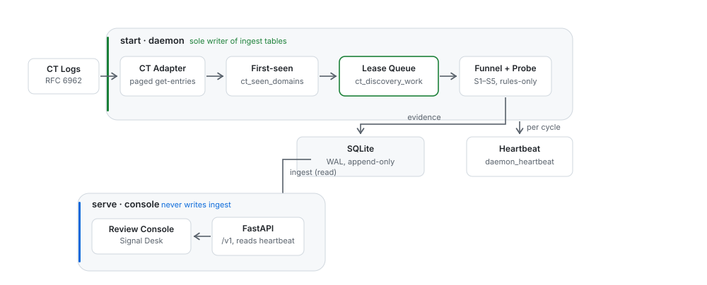

[English](README.md) | **简体中文**

# AI Tools Before Launch

在 AI 工具注册域名的当天就发现它 —— 靠监听证书透明日志，而不是等别人先发帖。

每个 AI 工具都需要一个域名，而域名必须先有 TLS 证书才能对外提供任何服务。
证书透明（Certificate Transparency）日志会在证书签发后的几分钟内将其公开。
Product Hunt 上的条目、GitHub 上的 star，都要等有人决定去推广这个产品才会出现
—— 那是一个人的主观决定，没有固定时间表。而 CT 日志条目是机械产生的：证书存在，
条目就在。这让它成为一个工具"至少已经存在"的最早公开信号。本工具监听配置好的
公共 CT 日志，维护首次出现的基线，并跑一条五级漏斗 —— 静态域名特征、RDAP 注册
年龄、DNS 解析情况、实时 HTTP 探测、可选的 LLM 分类 —— 最终让一位审核者只需面对
一小队**真正全新**、看起来像正经 AI 产品的域名，且每个都带着完整的证据链。

小而轻依赖：纯 HTTP，没有 WebSocket，不接第三方聚合服务，不需要 API key。
任何兼容 OpenAI 接口的 LLM 都能用。

## 工作原理



`start` 是 ingest 表的唯一写者。`serve` 只读这些表，只写 review 决策，
所以两个进程不会争抢游标。图源是 [`docs/architecture.json`](docs/architecture.json)。

流水线从左到右依次流转：

| 阶段 | 作用 |
|---|---|
| CT 日志 | 轮询配置的 RFC 6962 日志（默认：Cloudflare Nimbus 2026） |
| 首见基线 | `ct_seen_domains` —— 第一次见到才是信号 |
| S1 静态特征 | 域名形态打分：像品牌名 vs 随机垃圾域名（默认只写证据，`--min-name-score` 才让它真拦人） |
| S2 RDAP 年龄 | ≤30 天 → 第一档 · ≤90 天 → 第二档 · 更老 → 丢弃（端点表来自 IANA bootstrap，覆盖 1200+ TLD） |
| S3 DNS 是否存在 | 域名到底能不能解析？ |
| S4 实时探测 | 有边界的 HTTP 探测，带 SSRF 防护，输出证据引文 |
| S5 LLM 分类 | 可选，固定 schema，证据受限 |
| 审核队列 | 人工审核收件箱 |

每个阶段的输出都会被持久化，审核控制台会显示某个候选**为什么**出现在队列里。
探测失败的会自动重试（`ct_discovery_work`）—— 不需要另外的调度器。

## 快速开始

```bash
git clone https://github.com/Ne0x-ai/ai-tools-before-launch.git
cd ai-tools-before-launch
python3 -m venv .venv
.venv/bin/pip install -e .          # Windows: .venv\Scripts\pip install -e .
.venv/bin/python -m pytest -q       # 运行测试套件
```

> 仅限 macOS + Python 3.14：`site.py` 会跳过隐藏的 `.pth` 文件，导致可编辑安装
> （editable install）失效。这时改用 `bash dev_install.sh` 代替裸 pip —— 它做同样的
> 安装并附带该修复。Linux 和 Windows 永远不需要。

前台运行在所有平台上都一样：发起命令，它会一直跑到 `Ctrl-C`。下一节只讲当你
离开电脑时如何让它常驻。

## 命令

一共四个：

```bash
ai-tools-before-launch init --database ./ai-tools-before-launch.db        # 创建/打开数据库

ai-tools-before-launch start    --database ./ai-tools-before-launch.db    # 持续发现
ai-tools-before-launch serve  --database ./ai-tools-before-launch.db      # 审核收件箱 UI
ai-tools-before-launch status --database ./ai-tools-before-launch.db      # 已知与待处理的域名
```

### 持续发现

```bash
ai-tools-before-launch start \
  --database ./ai-tools-before-launch.db \
  --entries 500000 \
  --provider openai-compatible --base-url "https://api.deepseek.com" \
  --token-env DEEPSEEK_TOKEN --model "deepseek-chat"
```

一轮 = 轮询新的 CT 条目 → 严格的首见/RDAP/DNS 卡口 → 有边界的 HTTP 探测 → 候选
进入审核队列。重复传 `--log` 可以轮询更多日志源。它会一直跑到 Ctrl-C；加上
`--max-rounds` 后，日志源故障会以非零状态码退出，而不是伪装成"没有候选"。

默认情况下发现流程只跑规则（S1–S4，不带 LLM，不需要 API key）。要接上 S5 分类，
加上 `--provider openai-compatible` 以及对应的端点参数。已知可用的提供方：
DeepSeek（`deepseek-chat`）、MiniMax（`MiniMax-M3`）、OpenAI（`gpt-4o-mini`）、
Ollama（`http://localhost:11434`）、vLLM。推理模型也已处理（剥离思考前言、从围栏
代码块或尾部区块里提取 JSON、`base_url` 带不带 `/v1` 都能归一化）。

### 审核收件箱

```bash
ai-tools-before-launch serve --database ./ai-tools-before-launch.db
# 打开 http://127.0.0.1:8000/
```

首页就是候选收件箱：未决候选按审核优先级排序。点进某个候选可以看到已持久化的
证据，然后批准、暂缓、拒绝或加入黑名单。操作需要带上 `X-Actor-ID`，并会记录进
SQLite。

**控制台不读 CT 日志。** 采集只有一个写入者 —— `start` 守护进程；跑两个意味着
两个进程推进同一个游标。`serve` 只能**消化**守护进程已经放进队列的工作项
（`POST /v1/run/discovery`），并且它会告诉你当前属于哪种情况：`no_work` 且
`daemon.running: false` 表示根本没有人在采集；`no_work` 且
`daemon.running: true` 表示你已经追平了。在另一个终端里（或用 systemd/launchd）
跑 `start`，控制台才有东西可看。

### `start` 的行为

`start` 会把每一个新的 CT 条目一路扫到 tree head，使用有限并发；然后消化漏斗
队列，接着空转等待，再重复 —— 一个命令，最高速度，直到 Ctrl-C。全新的数据库会
从当前 tree head 开始；想先补一段历史窗口，就传 `--entries 500000`（或
`--hours 6`）。中断的运行会从已存游标处恢复；失败会被工作队列自动重试。

容量提示：像 Cloudflare Nimbus 2026 这种繁忙日志大约每小时有 **100 万条**条目，
所以 `--entries` 取 10^5 量级可以让首次扫描控制在一小时以内。消化吞吐受限于
RDAP 服务器的限速；几个并发旋钮（`--rdap-concurrency`、`--dns-concurrency`、
`--probe-concurrency`、`--page-fetch-concurrency`）用来在速度和"礼貌"之间取舍，
`--filter-retry-delay` 控制失败的 DNS/RDAP 检查多快会被重新排队重试。

## 你到底有多早？

这是整个项目唯一真正重要的数字，所以它每一轮都会吐出来，而不是靠感觉。每个
cycle 的 `start.cycle` 事件里有一个 `freshness` 对象，三个量回答三个不同的问题：

| 字段 | 回答什么 | 归谁 |
|---|---|---|
| `entries_behind` | 日志已经发布、但游标还没消化的条数 | 你的债 —— 可行动 |
| `processed_lag_seconds` | 你最新消化掉的那条，距今多少秒 | 你的债 + 日志自身的延迟 = 这次发现真实有多早 |
| `head_lag_seconds` | 直接读日志最尾部那条的年龄 | 日志的延迟 —— 这是任何人从 CT 都不可能突破的下限 |

```jsonc
{"event": "start.cycle", "cycle": 7, "freshness": {
  "entries_behind": 0, "processed_lag_seconds": 41.2, "head_lag_seconds": 41.2,
  "logs": [{"log": "cloudflare-nimbus2026", "tree_size": 981234567,
            "cursor": 981234567, "entries_behind": 0,
            "processed_lag_seconds": 41.2, "head_lag_seconds": 41.2}]}}
```

`entries_behind > 0` 说明**你**是瓶颈（日志尾部明明更新了，你没跟上），这时会额外
吐一条 `start.lagging`，并提示去调 `--page-fetch-concurrency` / `--page-size`。
`entries_behind == 0` 而 `head_lag_seconds` 仍然很大，说明是日志自己慢 —— 那不是
bug，那是这个方法的物理下限，调参也改不了。默认阈值为 120 秒
（`--lag-warn-seconds`）。

一个诚实的注意点：冷启动补历史（`--entries`）期间 `entries_behind` 天然很大，
警告会一直响 —— 那是真的落后，不是误报。

## HTTP API

默认只监听回环地址，除非指定 `--host 0.0.0.0`。API **没有任何认证** —— 如果绑定到
远程服务器，请把 8000 端口放在防火墙白名单之后，或通过 SSH 隧道访问
（`ssh -L 8000:127.0.0.1:8000 server`）。

| 方法 | 路径 | 说明 |
|---|---|---|
| `GET` | `/v1/review-queue` | 带优先级的收件箱投影 |
| `GET` | `/v1/candidates/{id}/review-context` | 最新版本 + 证据 |
| `GET` | `/v1/candidates/{id}/versions/{v}/review-context` | 不可变的历史版本 |
| `POST` | `/v1/candidates/{id}/versions/{v}/decisions` | 基于 `request_id` 幂等 |
| `POST` | `/v1/candidates/{id}/versions/{v}/decisions/{d}/revoke` | 撤销一次决策 |
| `POST` | `/v1/run/discovery` | 消化队列里到期的工作项（不读 CT） |
| `GET` | `/v1/discovery/overview` | 域名数、游标、漏斗统计、守护状态 |
| `GET` | `/v1/discovery/log` | 守护进程日志的尾部 |
| `GET` | `/healthz` | `{"ok": true}` |

## 7×24 常驻运行

之所以需要后台服务，只是为了让守护进程能扛住登出、崩溃和重启。游标持久化是可靠的：
任何重启之后它都从停止处续跑，绝不重扫。

### Linux —— systemd

```ini
# /etc/systemd/system/ai-tools-before-launch.service
[Unit]
After=network-online.target

[Service]
ExecStart=/opt/ai-tools-before-launch/.venv/bin/ai-tools-before-launch start --database /var/lib/ai-tools-before-launch/dh.db
Restart=always
RestartSec=10

[Install]
WantedBy=multi-user.target
```

```bash
sudo systemctl daemon-reload
sudo systemctl enable --now ai-tools-before-launch    # 启动 + 开机自启
sudo systemctl stop ai-tools-before-launch            # 关闭开关
journalctl -u ai-tools-before-launch -f               # 查看日志
```

### macOS —— launchd

保存为 `~/Library/LaunchAgents/ai.neoxue.ai-tools-before-launch.plist`（必须使用绝对路径）：

```xml
<?xml version="1.0" encoding="UTF-8"?>
<!DOCTYPE plist PUBLIC "-//Apple//DTD PLIST 1.0//EN"
  "http://www.apple.com/DTDs/PropertyList-1.0.dtd">
<plist version="1.0"><dict>
  <key>Label</key><string>ai.neoxue.ai-tools-before-launch</string>
  <key>ProgramArguments</key><array>
    <string>/Users/YOU/ai-tools-before-launch/.venv/bin/ai-tools-before-launch</string>
    <string>start</string>
    <string>--database</string>
    <string>/Users/YOU/ai-tools-before-launch/dh.db</string>
  </array>
  <key>RunAtLoad</key><true/>
  <key>KeepAlive</key><true/>
  <key>StandardOutPath</key><string>/Users/YOU/ai-tools-before-launch/start.log</string>
  <key>StandardErrorPath</key><string>/Users/YOU/ai-tools-before-launch/start.err.log</string>
</dict></plist>
```

```bash
launchctl bootstrap gui/$(id -u) ~/Library/LaunchAgents/ai.neoxue.ai-tools-before-launch.plist  # 开启
launchctl bootout gui/$(id -u)/ai.neoxue.ai-tools-before-launch                                 # 关闭
```

笔记本注意：合盖会让 Mac 睡眠并暂停发现流程；如果需要真正的 24 小时覆盖，请关闭
自动睡眠。

### Windows —— 任务计划程序（自带）或 NSSM

```bat
schtasks /Create /TN ai-tools-before-launch /SC ONSTART /RU SYSTEM ^
  /TR "C:\ai-tools-before-launch\.venv\Scripts\ai-tools-before-launch.exe start --database C:\ai-tools-before-launch\db\dh.db"
```

如需失败后自动重启，打开 `taskschd.msc`，在任务设置的"失败时重新启动"里配置；
或者装 [NSSM](https://nssm.cc) 注册成真正的 Windows 服务，用
`nssm install ai-tools-before-launch <exe> <args>` 安装，`nssm start/stop` 当开关。

## 项目结构

```
src/ai_tools_before_launch/
  api.py        — FastAPI 路由
  cli.py        — `ai-tools-before-launch` 入口（init/status/start/serve）
  pipeline.py   — S4 探测 + 重试策略 + 候选创建
  crawler/      — HTTP 探测、L1 内容分析、SSRF 安全传输
  filter/       — S1 静态特征、S2 RDAP 年龄、S3 DNS、漏斗
  ingest/       — RFC 6962 CT 日志适配器 + 编排器 + 常驻执行器
  llm/          — 固定 schema 的提供方适配层（S5）
  domain/       — PSL 归一化、候选、审核、重试策略
  storage/      — 只追加（append-only）的 SQLite 存储
```

## 非目标

- 不做生产级认证；默认只绑回环地址。
- 不自动发邮件、不自动发布。审核决策只留在本地。
- 不绑定特定厂商：分类器只说 OpenAI 兼容的 chat-completions 方言。

## 许可证

[MIT](LICENSE)。
